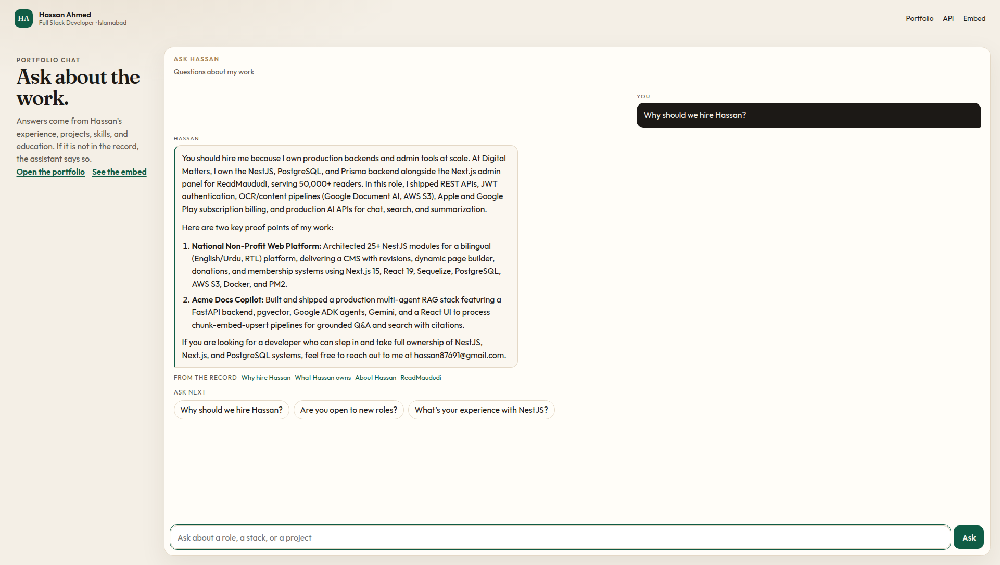
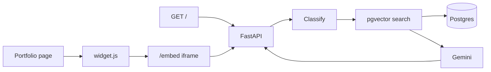
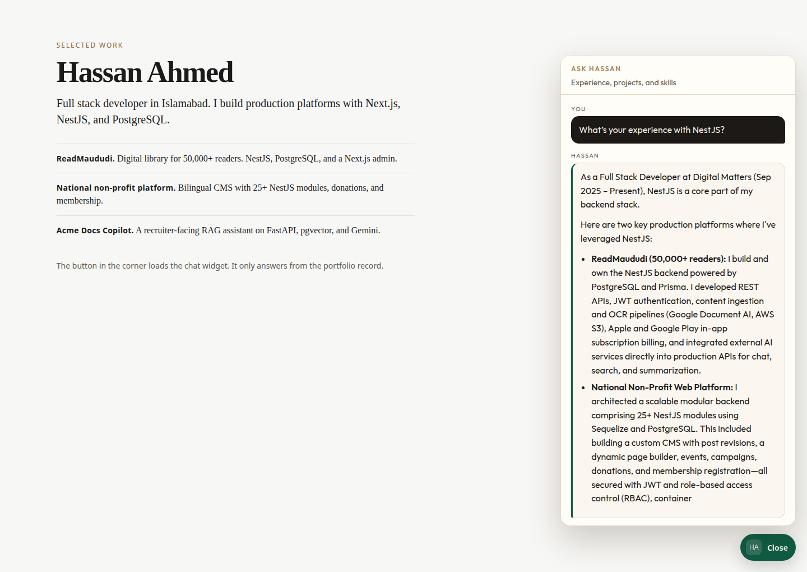

# Portfolio chat

A recruiter-facing chatbot for [Hassan Ahmed](https://genuine-kleicha-d80d7d.netlify.app/). It answers questions about his experience, projects, skills, and education from Postgres, not from the open web.

Live API: [https://chat-with-me.fastapicloud.dev](https://chat-with-me.fastapicloud.dev)



## Features

- Grounded answers with citations back to the portfolio
- Streaming replies (`text/event-stream`)
- Job-description match against the same records
- Embeddable widget and an iframe that only shows the chat
- Branding overrides for title, subtitle, accent, placeholder, and position
- `/health` returns as soon as the process is up, even if Postgres is still waking

## Stack

Python 3.12, FastAPI, Postgres with pgvector, Gemini (`gemini-3.6-flash` and `gemini-embedding-001`). Local development can run without a Gemini key.

## Architecture



`widget.js` opens `/embed` on the API host. The frame sends `POST /v1/chat/stream`. The API classifies the question, retrieves portfolio rows, and asks Gemini to answer only from those rows.

## Local setup

Python 3.12, Docker, and a virtualenv.

```bash
cp .env.example .env
docker compose up -d

python3.12 -m venv .venv
source .venv/bin/activate
pip install -r requirements.txt

# No Gemini key: LLM_MODE=mock stores lexical rows and composes from them.
# With a key, leave LLM_MODE=auto and put the key in .env.
python -m app.seed
uvicorn main:app --reload
```

Run `python -m app.seed` from `api/` (or `python -m app.seed` with `api` on `PYTHONPATH`). From the repo root the module path is `api/app`, so this also works:

```bash
cd api && python -m app.seed && cd ..
uvicorn main:app --reload
```

- Chat: http://127.0.0.1:8000
- Embed demo: http://127.0.0.1:8000/examples/embed.html
- Swagger: http://127.0.0.1:8000/docs

Postgres is published on **5433** so it does not collide with another local database.

`LLM_MODE=mock` is for local demos without `GEMINI_API_KEY`. It does not call Gemini. Production on FastAPI Cloud keeps `LLM_MODE=auto` or `gemini`.

## Environment variables

Set these in the host’s secret store. Names only; copy `.env.example` and fill the placeholders locally. Do not commit `.env`.

| Name | Role |
| --- | --- |
| `GEMINI_API_KEY` | Gemini calls. Required when `LLM_MODE` is `auto` or `gemini`. |
| `GOOGLE_API_KEY` | Used only when `GEMINI_API_KEY` is empty. |
| `DATABASE_URL` | Postgres connection URI. Supabase needs `sslmode=require`. |
| `ADMIN_SECRET` | Protects `POST /v1/seed` and `POST /v1/reset`. |
| `CORS_ORIGINS` | Comma-separated origins, or `*` for any site. |
| `CORS_ORIGIN_REGEX` | Optional extra origin pattern. |
| `PORTFOLIO_URL` | Citation links. |
| `CHAT_MODEL` | Gemini chat model. |
| `PUBLIC_API_URL` | Origin the widget and `/embed` call. Defaults to the live API. |
| `LLM_MODE` | `auto`, `gemini`, or `mock`. |
| `DB_CONNECT_TIMEOUT` | Seconds before a database connection attempt gives up. |
| `DB_READY_WAIT_SECONDS` | How long a chat request waits for schema setup. |
| `WIDGET_TITLE` | Default widget title. |
| `WIDGET_SUBTITLE` | Default widget subtitle. |
| `WIDGET_ACCENT` | Default accent, `#` plus six hex digits. |
| `WIDGET_PLACEHOLDER` | Default input placeholder. |
| `PORT` | Set by FastAPI Cloud. Local default is `8000`. |

`PUBLIC_API_URL` and `WIDGET_API_BASE` are the same setting. `WIDGET_API_BASE` is only a fallback name.

## Deploy

The API is already on FastAPI Cloud:

[https://chat-with-me.fastapicloud.dev](https://chat-with-me.fastapicloud.dev)

Stay on that service. This repo’s entrypoint is the root `main.py` (`main:app`), which is what FastAPI Cloud loads. The process listens immediately and applies the schema on a background thread, so a slow or paused database does not hold the port open until the platform kills the boot.

`GET /health` is always HTTP 200 once the process is up. `db` is `starting`, `ok`, `error`, or `unconfigured`. `schema_status` is `pending` or `ok`.

After this branch is merged, redeploy that same service from the repo root:

```bash
fastapi login
fastapi deploy
```

No new host, database, or secret is required for the redeploy if the service already answers `/v1/chat`. Optional settings (`PUBLIC_API_URL`, `WIDGET_*`, `LLM_MODE`, `DB_CONNECT_TIMEOUT`) can be added in the FastAPI Cloud env screen. Leave secrets out of the shell history when you can; the CLI’s secret flag is there for `DATABASE_URL`, `GEMINI_API_KEY`, and `ADMIN_SECRET`.

Check the redeploy:

```bash
curl https://chat-with-me.fastapicloud.dev/health
curl https://chat-with-me.fastapicloud.dev/
```

`/` should be the chat page. `/health` should report `"db": "ok"`.

Seed only when `api/seed/portfolio.json` changes. From a machine that can reach the database, point `DATABASE_URL` at the Supabase session pooler (IPv4, port 5432, `sslmode=require`) and run `python -m app.seed` inside `api/`. Or, after deploy:

```bash
curl -X POST https://chat-with-me.fastapicloud.dev/v1/seed \
  -H "X-Admin-Secret: $ADMIN_SECRET"
```

`POST /v1/reset` deletes the stored records. Keep `ADMIN_SECRET` long.

## Widget

Paste this on the portfolio site. The script defaults to the live API. Override it with `data-api` when you point at another origin.

```html
<script
  src="https://chat-with-me.fastapicloud.dev/widget.js"
  data-title="Ask Hassan"
  data-subtitle="Experience, projects, and skills"
  data-accent="#0f5c45"
  data-placeholder="Ask about NestJS or a project"
  data-position="right"
  async
></script>
```

| Attribute | Effect |
| --- | --- |
| `data-api` | API origin. Default `https://chat-with-me.fastapicloud.dev`. |
| `data-title` | Launcher label and frame title. |
| `data-subtitle` | Line under the title inside the frame. |
| `data-accent` | `#` and six hex digits. |
| `data-placeholder` | Input placeholder. |
| `data-position` | `right` (default) or `left`. |
| `data-open` | `true` opens the panel on load. |

The same knobs work on the iframe:

```html
<iframe
  title="Ask Hassan"
  src="https://chat-with-me.fastapicloud.dev/embed?title=Ask%20Hassan&accent=%230f5c45"
  style="width:400px;height:640px;border:0;border-radius:18px"
></iframe>
```

A sample host page is served at `/examples/embed.html`.




The screenshots and the GIF were captured against the live FastAPI Cloud API, which already answers `/v1/chat`. The pages in the captures are this branch’s chat UI, because the live host still returns 404 for `/` until it is redeployed.

## Endpoints

| Method | Path | What it does |
| --- | --- | --- |
| GET | `/` | Chat page |
| GET | `/embed` | Chat frame for the widget |
| GET | `/widget.js` | Loader script |
| GET | `/examples/embed.html` | Sample page that loads the widget |
| GET | `/health` | Process up; database status in the body |
| POST | `/v1/chat` | JSON answer and citations |
| POST | `/v1/chat/stream` | SSE: `meta`, `token`, `done` |
| POST | `/v1/match-jd` | Compare a job post to the record |
| GET | `/v1/suggestions` | Starter questions |
| POST | `/v1/seed` | Reload `api/seed/portfolio.json` (`X-Admin-Secret`) |
| POST | `/v1/reset` | Delete stored rows (`X-Admin-Secret`) |

```bash
curl https://chat-with-me.fastapicloud.dev/v1/chat \
  -H 'Content-Type: application/json' \
  -d '{"question":"Why should we hire you?"}'
```
